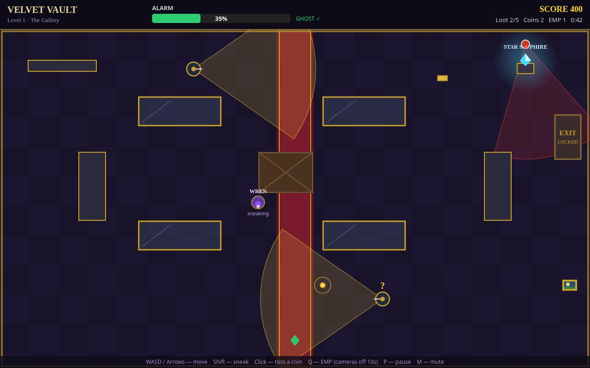

# Velvet Vault — A Midnight Heist

A complete top-down stealth heist game that runs in a desktop browser from
static files — no network, no build step. Built for the make.fun bounty
[Make the best heist game](https://make.fun/c/best-heist-game-20261122-0559).

## The heist

Wren the thief has one night to lift the **Star Sapphire** from three
guarded rooms — **The Gallery**, **The Vault Hall** and **The Penthouse** —
and slip out the exit door. Guards patrol in yellow vision cones, cameras
sweep in red, and the alarm meter climbs every second Wren is seen. At
100%, the run is over.

## How to play

Serve `game/` with any static server (`node serve.ts`, then open
http://localhost:8080) and play with keyboard and mouse:

- **WASD / Arrows** — move
- **Shift** — sneak (slower, much harder to spot, even while standing still)
- **Click** — toss a coin (3 per level) to pull a patrol toward the clink
- **Q** — EMP (1 per level): cameras go dark for 10 seconds
- **P** — pause, **M** — mute

Stand beside the Star Sapphire and hold still for 2 seconds to lift it —
then the exit door opens. Bonus loot (gold, emeralds, paintings) adds
score, and a level cleared with the alarm never above 40% earns the
**Ghost** bonus. Score = loot + time bonus + Ghost bonus.

## What is inside

- `game/index.html` — the page; `game/src/main.js` boots the game
- `game/src/config.js` — every tuning number in one place
- `game/src/rng.js` — seeded randomness (mulberry32), so levels are deterministic
- `game/src/levels.js` — the three hand-built rooms
- `game/src/engine.js` — the rules: guard AI (patrol / investigate / chase),
  camera sweeps, line of sight, the alarm, loot, the Sapphire channel, scoring
- `game/src/render.js` — the canvas renderer: floor, cones, HUD, overlays
- `game/src/audio.js` — all sound synthesized with WebAudio, no audio files
- `game/src/input.js` — keyboard and mouse input
- `game/src/shots.js` — the four deterministic screenshot scenes
- `main.ts` — the hand-in program: copies `game/` and `screenshots/` to
  `/output` and writes `dossier.json` with the vendored make.fun library
- `screenshots/` — four real renders of the game's own code (1280×800)

All art is drawn in code and all sound is synthesized; the names, rooms and
characters are original.

## License

MIT — see [LICENSE](LICENSE).
