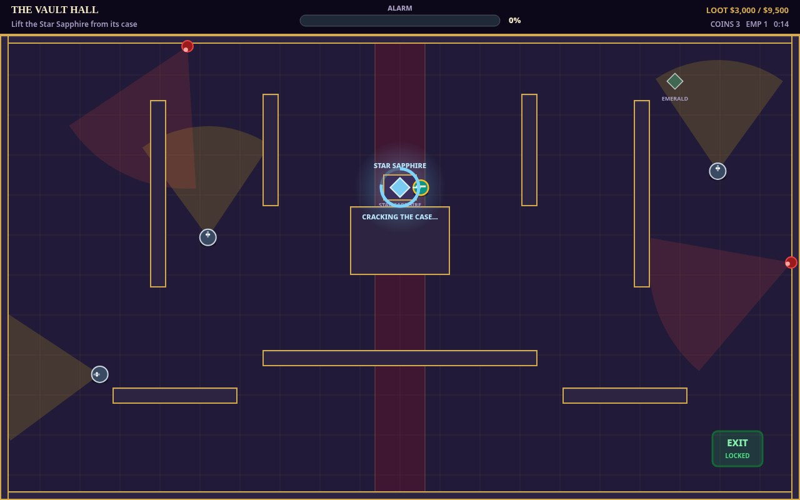

[](https://make.fun/bounty/best-heist-game-20261122-0559)
[](https://make.fun/bounty/best-heist-game-20261122-0559)
[](https://make.fun/bounty/best-heist-game-20261122-0559)

# Velvet Vault — A Midnight Heist

You are **Wren**, gentleman thief. Tonight the Velvet Vault shows the **Star Sapphire** — and a house full of guards and cameras. Lift the Sapphire, grab what else you can carry, and reach the east exit before the alarm hits 100%.

An entry for the [make.fun best heist game bounty](https://make.fun/bounty/best-heist-game-20261122-0559).



## How to play

Open `game/index.html` in a desktop browser, or serve the folder and open it:

```sh
node serve.ts
# then open http://localhost:8080
```

- **WASD / Arrow keys** — move
- **Shift** — sneak (slow, quiet, harder to spot)
- **Click** — throw a coin to pull guards away (3 per level)
- **Q** — EMP: black out every camera for 10 seconds (1 per level)
- **Stand still by the Sapphire** — crack its case (2 seconds)
- **P / Esc** — pause · **M** — mute · **R** — retry after being caught

## The heist

- **3 levels** — The Gallery, The Vault Hall, The Penthouse — each a single room with its own patrols, cameras and loot.
- **Guards with vision cones** — they patrol, pause, investigate noises and thrown coins, and give chase when they spot you. Walk straight into one and you are caught.
- **Security cameras** — sweeping red cones; an EMP blacks them out.
- **Alarm meter** — climbs while any cone holds you, cools while unseen. At 100% the house wakes up and the run is over.
- **Loot** — the Star Sapphire (crack its case), gold bars, emeralds, a velvet portrait. Loot value, a time bonus and a Ghost bonus (alarm never over 40%) make your score.
- **Tools at a cost** — coins and EMP charges are scarce; spending one is a real decision.
- **Sound** — every effect is synthesised with the Web Audio API; no audio files, no network requests. The whole game is static files under `game/`.

## Shots

The screenshots under `screenshots/` are real renders of the game's own code, staged deterministically with `?shot=` (`shots.json` lists them): the mid-heist cover, the title briefing, the caught moment, and the clean getaway after all three vaults.

## Layout

- `game/` — the playable game as static files (`index.html` + ES modules under `src/`, one job per file)
- `main.ts` — the hand-in program: copies `game/` and `screenshots/` to `/output` and writes `dossier.json`
- `vendor/makefun-game.ts` — the kit's dossier library, unchanged
- `screenshots/` — 4 screenshots of the game, taken from its own code
- `serve.ts` — a tiny static server for local play-testing

## License

MIT — see [LICENSE](LICENSE).
